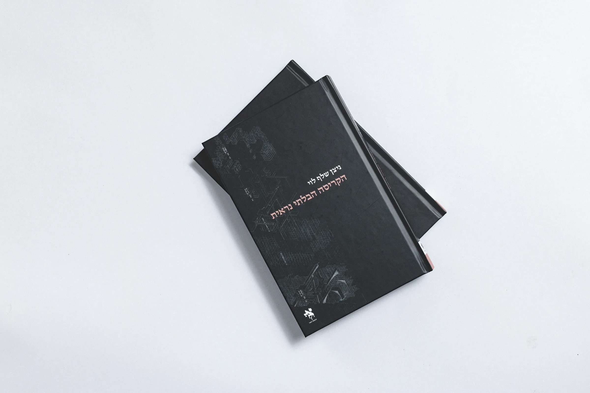
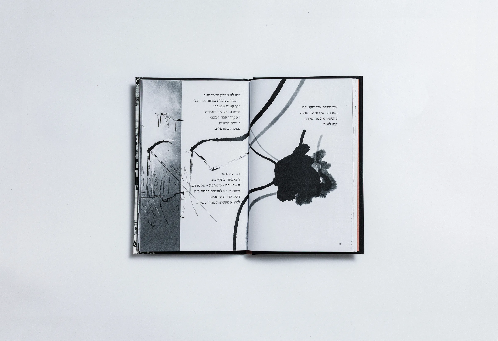
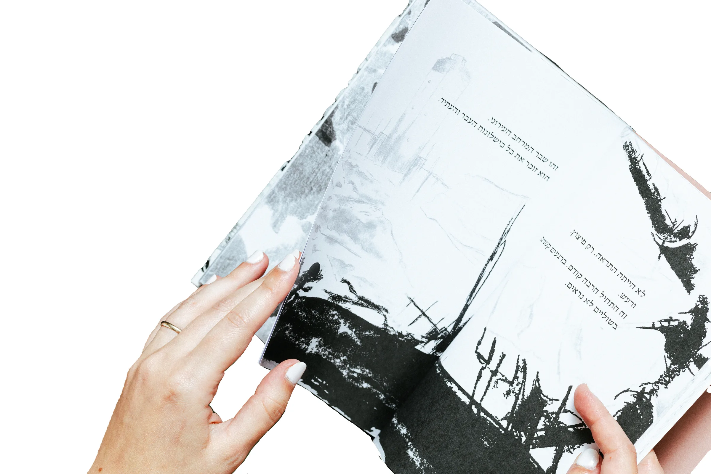

# The Invisible Collapse

<div align="center">
  <a href="https://studionsl.com">
    
  </a>

  <br><br>

  <strong>הקריסה הבלתי נראית</strong><br>
  An editorial experience about architecture, fracture, and rebuilding.

  <br><br>

  <a href="https://studionsl.com"><strong>Visit the website</strong></a>
  &nbsp;·&nbsp;
  <a href="https://nitzanshelef.myportfolio.com">View the portfolio</a>
</div>

## About the project

**The Invisible Collapse** (*הקריסה הבלתי נראית*) is the debut book by architect, artist, and designer **Nitzan Shelef Levy**. It brings poetic prose and speculative architectural imagery together to examine the Israeli “sinkhole” as a metaphor for social and political collapse—and to imagine new ways of living alongside the fracture.

This website extends the book into a responsive, Hebrew-first digital experience. It combines editorial storytelling, architectural films, book photography, biographical context, and direct purchase options in a carefully composed right-to-left interface.

<table>
  <tr>
    <td width="50%">
      
    </td>
    <td width="50%">
      
    </td>
  </tr>
</table>

## Experience

- Rotating photographic hero with reduced-motion support
- Long-form editorial sections designed for Hebrew and RTL reading
- Swipeable architectural film gallery
- Responsive book gallery and author portrait
- Accessible navigation, keyboard controls, and semantic media labels
- Purchase flows for local pickup and delivery
- Search and social metadata for rich link previews

## Built with

- [React 18](https://react.dev/)
- [Vite 5](https://vite.dev/)
- CSS
- Docker and Nginx

## Run locally

You will need Node.js 20 or newer and npm.

```bash
npm ci
npm run dev
```

Vite will print the local development address in the terminal.

| Command | Purpose |
| --- | --- |
| `npm run dev` | Start the development server |
| `npm run build` | Create an optimized production build in `dist/` |
| `npm run preview` | Preview the production build locally |

## Project structure

```text
.
├── public/                  # Public metadata, social image, robots and sitemap
├── src/
│   ├── assets/
│   │   ├── logos/          # Portfolio and social icons
│   │   ├── photos/         # Original and web-optimized photography
│   │   ├── refinements/    # Production-ready architectural artwork
│   │   └── videos/         # Architectural films
│   ├── App.jsx             # Page content, sections and interactions
│   ├── main.jsx            # React entry point
│   └── styles.css          # Layout, typography and responsive styling
├── index.html              # HTML shell and SEO metadata
├── Dockerfile              # Production container image
├── nginx.conf              # Static-site server configuration
└── vite.config.js          # Vite configuration
```

The `book-sources/` directory contains original publication and project documents. It is not included in the production bundle.

## Production

Create the optimized static build:

```bash
npm run build
```

Or build and run the production container:

```bash
docker build -t invisible-collapse .
docker run --rm -p 8080:8080 invisible-collapse
```

The container serves the site at [localhost:8080](http://localhost:8080).

## Credits

- Concept, book, and website: **Nitzan Shelef Levy**
- Photography: **Yuval Urbach (יובל אורבך)**

All artwork, photography, writing, and project materials remain the property of their respective creators.
